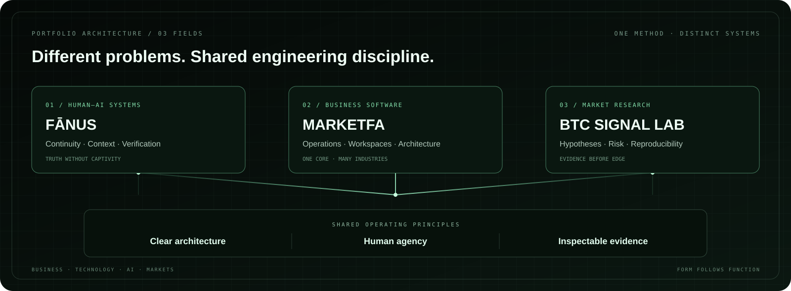
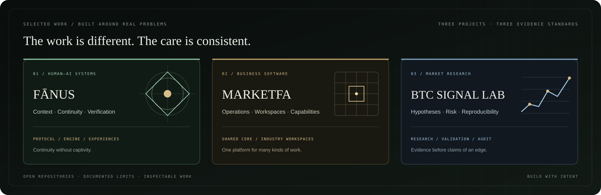
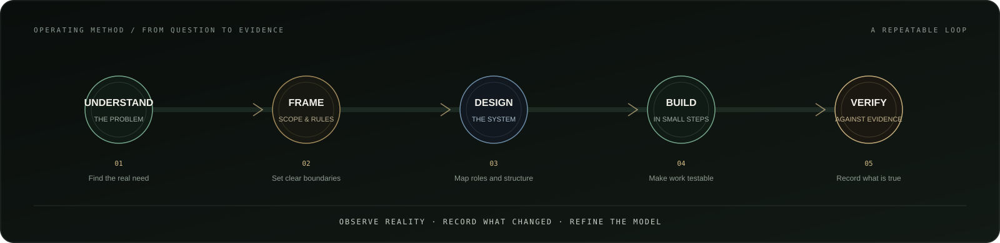
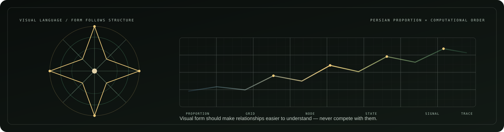

BUSINESS SYSTEMS &nbsp;·&nbsp; DIGITAL PRODUCTS &nbsp;·&nbsp; APPLIED AI &nbsp;·&nbsp; MARKET RESEARCH

# Amin Shahsaheb

I work where **business, technology and systems meet**. I turn broad questions into structured products, build the systems behind them, and test important claims against evidence.

My work moves across different fields, but follows one discipline:

> **Understand the problem. Design the system. Build with care. Observe what happens. Verify what is true.**

[Business profile](https://biokart.ir/amin-shahsaheb) · [GitHub repositories](https://github.com/aminshahsaheb?tab=repositories) · [Contact](#connect)

---

## The work at a glance

I build in three distinct areas. Each project has its own purpose, boundaries and evidence standard.

| Field | Project | Focus |
|---|---|---|
| **Human–AI systems** | [Fānus](https://github.com/aminshahsaheb/Fanus-Living-Seal) | Context, continuity, epistemic honesty and verification |
| **Business software** | [MarketFa](https://github.com/aminshahsaheb/marketfa-platform) | A multi-industry business operations platform |
| **Market research** | [BTC Signal Lab](https://github.com/aminshahsaheb/btc-signal-lab) | Reproducible research into Bitcoin movement, risk and validation |

---

## Selected work

### 01 — Fānus · Human–AI continuity and verification

**A research and engineering project about honest, inspectable human–AI interaction.**

Fānus explores how an AI system can preserve useful context without creating dependence, and how it can state what it knows, what it does not know, and what it cannot verify.

The work separates a canonical protocol and engine from the interfaces that expose it.

- **Living Seal** — protocol, research, runtime and verification foundation.
- **Fānus App** — conversation and continuity experience.
- **Fānus Presence** — public presence and runtime observation.
- **Fānus Blueprint** — visual system architecture and inspection.

**Guiding principle:** Continuity without captivity.

[Core repository](https://github.com/aminshahsaheb/Fanus-Living-Seal) · [App](https://github.com/aminshahsaheb/fanus-app) · [Presence](https://github.com/aminshahsaheb/fanus-presence) · [Blueprint](https://github.com/aminshahsaheb/fanus-blueprint)

### 02 — MarketFa · Multi-industry business platform

**A business platform designed around different kinds of work, not one generic shop workflow.**

A person should be able to select their occupation and work inside a workspace that reflects the needs of that business. Retail is one vertical. Service, repair, project work, food service, wholesale and manufacturing need their own capabilities and rules.

The architecture uses a shared identity and tenant core, explicit business profiles, server-enforced permissions, and a clear separation between domain logic and interface.

**Current boundary:** Core tenant and identity administration work is present. Authentication-provider integration, browser login and recovery, accounting implementation, and industry-specific workflows are not complete. The project is not production-ready for live financial records.

[Explore MarketFa](https://github.com/aminshahsaheb/marketfa-platform)

### 03 — BTC Signal Lab · Evidence-first market research

**A research workspace for testing market hypotheses without confusing a promising result with a proven trading edge.**

The project separates movement timing, directional hypotheses, risk checks and execution validation. It uses reproducible data handling, explicit research rules, documented decisions and pre-defined evidence gates.

A statistical result or a passing engineering check is not proof of profitability.

**Current boundary:** No strategy is established as profitable or independently validated. Several research components remain drafts or historical artifacts. The repository records these limits instead of presenting them as completed results.

[Explore BTC Signal Lab](https://github.com/aminshahsaheb/btc-signal-lab)

---

## How I work

I use a repeatable process:

1. **Understand** — identify the real problem, context and constraints.
2. **Frame** — define scope, users, assumptions and success criteria.
3. **Design** — map the architecture, responsibilities and boundaries.
4. **Build** — make small, reviewable and testable changes.
5. **Verify** — inspect the result, record evidence and revise the model.

A finished interface is not proof that the underlying system works. A passing test is not proof that a product has market fit. Each claim needs the right evidence.

---

## Design language

I am drawn to the meeting point of **Persian geometric form and computational structure**: proportion, symmetry, radial patterns, grids, nodes and traces.

I use these ideas as a design system, not as decoration. The visual form should make the underlying structure easier to understand.

---

## Principles

| Principle | What it means in practice |
|---|---|
| **Truth before presentation** | Never make a claim stronger than its evidence. |
| **Clear boundaries** | Separate responsibilities, permissions and sources of truth. |
| **Human agency** | Build tools that help people understand and act. |
| **Evidence over assumption** | Test important ideas and record what remains unknown. |
| **Continuity without captivity** | Preserve useful context without creating dependence. |
| **Architecture with purpose** | Every layer and visual element must have a reason to exist. |

---

## Connect

  
  
  
  

STRATEGY → ARCHITECTURE → PRODUCT → EVIDENCE

**Best Never Rest**

Built with curiosity, discipline and respect for reality.

